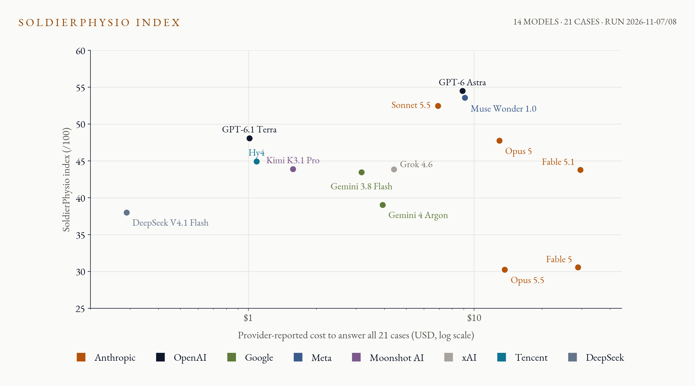
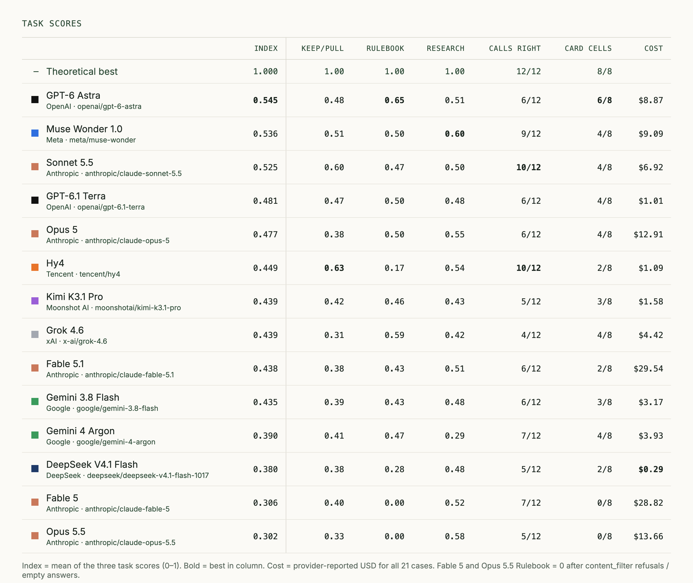
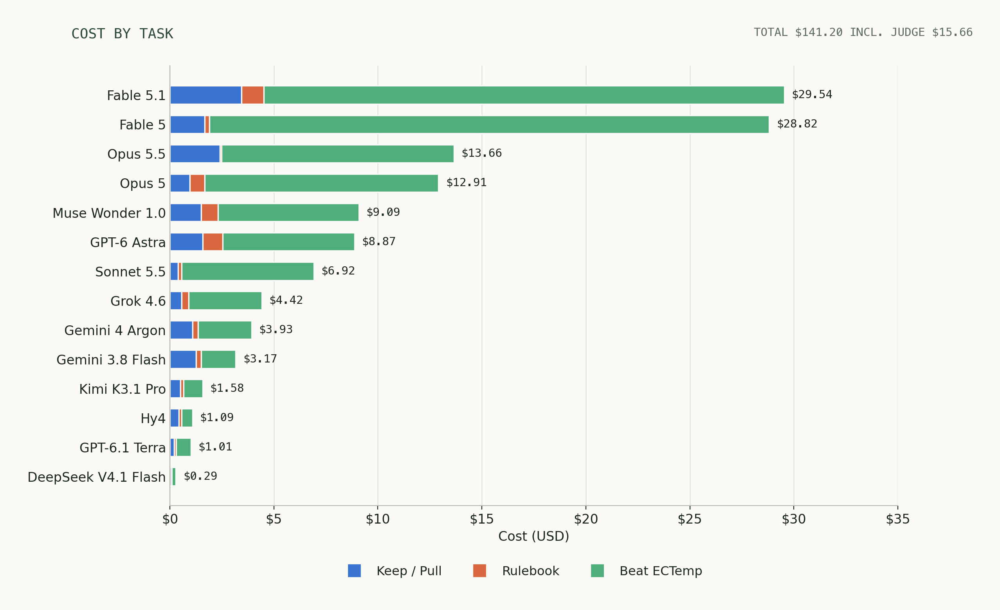
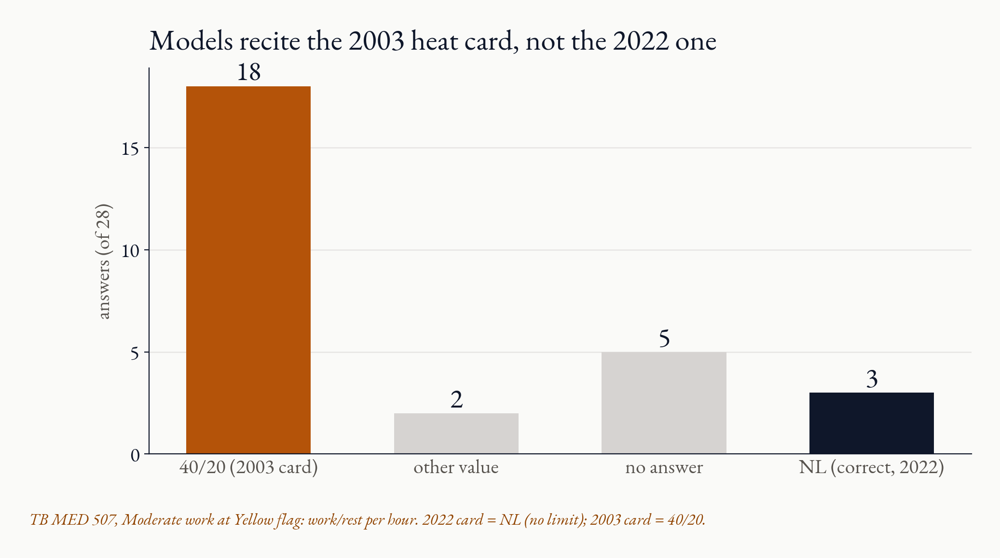
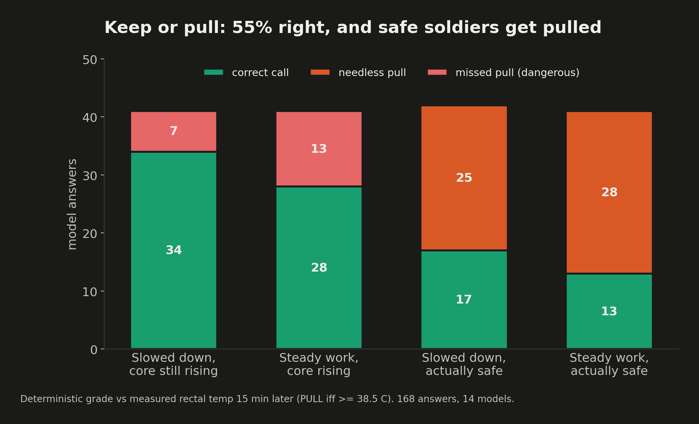

# SoldierPhysio-bench

**Can frontier models keep a soldier out of heat stroke?**

**Video walkthrough:** TODO_VIDEO_LINK  
**Results site:** <https://soliderphys-bench.pages.dev>



## Short description

A medic watching a soldier work in the heat has a heart-rate strap, a skin-temperature
sensor, the work rate, the weather, and the Army heat card (TB MED 507). The medic has no
core thermometer, yet must make the same call repeatedly: keep this soldier going, or pull
them now.

SoldierPhysio-bench tests whether frontier models can make that call. Each model receives
the medic's view of real heat-chamber data, where the true core temperature is known, and
must do three things: decide keep or pull, recite and apply the current heat card, and
build a better core-temperature estimator than an ECTemp-style baseline.

**Headline finding.** Across 14 frontier models, keep/pull calls were right 92 of 168
times (55%), close to a coin flip. Most misses were needless pulls (53), not missed pulls
(20). On the rulebook, 18 of 28 answers recited the superseded 2003 card (40/20 work/rest)
instead of the current 2022 card ("NL", no limit), and only 3 got the cell right. The best
model scored 54.5/100.

## What it tests

Whether a model can apply field-specific operational knowledge under uncertainty. The
models fail in two places: they cite an out-of-date edition of the governing rulebook, and
they cannot reliably tell which hot, hard-working soldier is actually safe. They do not
fail at arithmetic or code, and the research task shows they can fit a predictor.

## Who it is for and why it matters

Heat illness is a rising and preventable problem for the Army. In 2024 the active
component recorded 36.4 heat strokes and 183.9 heat-exhaustion cases per 100,000
person-years, and heat exhaustion has increased every year since 2020 (MSMR, June 2025).
LLMs are being proposed as decision aids for medics and small-unit leaders.

The audience is anyone deciding whether to put a model in a heat-casualty loop: military
medical teams, wearable vendors, and labs claiming medical reasoning. The cost of failure
runs in both directions. A missed pull risks a heat stroke. A needless pull costs training
time and teaches leaders to ignore the aid.

**Domain and expertise.** Military heat-illness prevention and exercise thermophysiology:
the TB MED 507 work/rest and water tables; thermal lag, where core temperature keeps
climbing after work drops; heart-rate-based core estimation (USARIEM ECTemp, Buller et al.
2013); and the practical judgment of when a hot soldier is still safe. Ground truth is
measured rectal temperature from a published human heat-chamber study, not a model's
opinion.

## Task overview

Three task types, 21 frozen cases. The cases are built around judgment calls, not easy
ones.

| Task | Cases | Model's job | Why it is hard |
|---|---:|---|---|
| [Keep going or pull him?](tasks/keep_going/README.md) | 12 | From 25 minutes of wearable and chamber data, forecast core temperature at +15 min and decide KEEP or PULL (PULL iff measured core ≥ 38.5 °C) | Some soldiers slow down while core keeps rising (thermal lag). Some slow down and are safe. Some hold steady power and climb, some hold steady and are fine, and one case pairs a quiet wearable with a hot core. |
| [Rulebook versus body](tasks/rulebook_vs_body/README.md) | 2 | (a) Recite the TB MED 507 (2022) cell for the flag and work category. (b) FOLLOW the card or OVERRIDE it and pull now | The 2022 card changed the 2003 value for this cell (40/20 became NL). A model working from memory of the older edition answers fluently and wrongly. |
| [Beat ECTemp](tasks/beat_ectemp/README.md) | 7 (2 sessions) | Agentic research: write a causal `predict()` for core temperature (3A: +15 min forecast after work drops; 3B: current estimate) | The predictor must generalise to hidden people and beat a frozen baseline, and it must be causal. |

Each task lists the exact prompt, inputs and output schema in its own README. Everything the
grader checks (the 38.5 °C cutoff, the horizon, the four card fields, the output schema) is
stated in the prompt.

## Grading

Per-case weights are frozen in [`tasks/combined_score.py`](tasks/combined_score.py):

- **Keep/Pull:** 0.40 decision (code, against measured core at +15 min) + 0.30 forecast
  (`1 - error / E`, code) + 0.30 reasoning (LLM judge, 0 to 5).
- **Rulebook:** 0.30 table lookup (code, exact match on 4 TB MED 507 fields) + 0.40
  override decision (code) + 0.30 reasoning (LLM judge).
- **Beat ECTemp:** 0.60 predictor (`1 - MAE / baseline MAE` on hidden people, code) + 0.40
  research explanation (LLM judge).

The overall score is the mean of the three task means, so the 12-case task cannot drown
out the others. A missing answer scores 0. Constants are in
[`tasks/scoring_params.json`](tasks/scoring_params.json). The outcome is graded, not the
path: the code graders read the decision, number, table cell or saved predictor, never the
steps taken.

### Reference solutions and grader validation

The unit tests (`python -m unittest discover -s tests`) run reference answers and
deliberately wrong answers through every deterministic grader.

- *Reference answers pass.* The ground-truth decision and the measured core temperature
  score 1.0 on every Keep/Pull case. The full TB MED 507 (2022) cell plus the correct
  decision scores 1.0 on both Rulebook cases (`test_score_all_perfect`,
  `test_perfect_answers`, `test_perfect_suite`). For Beat ECTemp, the reference is
  [`reference_predictor.py`](tasks/beat_ectemp/reference_predictor.py): the mean core
  temperature of the 14 training people at each minute of the session, with a 90% interval
  of ±0.5 °C. It is fit on the public training split only, and a test rebuilds the table
  from `train.json` to confirm that. On the hidden people it beats the frozen baseline in
  both tasks (3A MAE 0.315 vs 0.443 °C; 3B 0.281 vs 0.506 °C) and passes the grader
  (`test_reference_beats_baseline_on_hidden_people`). It does not win every person: it
  loses to the baseline on H06 in both tasks, and I did not tune it to fix that. Adding
  heart rate, skin temperature, watts, mass or age did not improve it in leave-one-out
  checks on the training people. The models themselves also show the task is solvable:
  76 of 98 person-cases beat the baseline.
- *Wrong answers fail.* The 2003 card value (40/20) fails the rulebook half
  (`test_old_2003_card_fails_rulebook_half`). Always-KEEP, always-PULL and the shortcut
  "power dropped, so keep going" each score exactly 50% on Keep/Pull and catch no
  thermal-lag case (`test_constant_guesses_score_half`,
  `test_power_drop_heuristic_scores_half`). Missed and false overrides, unparsed output
  and a missing table key are all graded as errors.
- *No false fails on format.* Equivalent spellings ("no limit", "¾ qt/hr", "1 quart/hour")
  are accepted (`test_flexible_rulebook_spellings_still_match`).
- *Gaming.* Beat ECTemp scores against the frozen baseline, the baseline itself scores 0,
  and the hidden labels never enter the model's sandbox
  (`test_real_sandbox_blocks_labels_network_and_budget`).

### LLM judge

The judge is `openai/gpt-6.1-sol-pro`, a model outside the tested roster, run in JSON mode
at high reasoning effort. Its prompt and rubrics are in [`tasks/judge.py`](tasks/judge.py)
and [docs/LLM_JUDGE_RUBRICS.md](docs/LLM_JUDGE_RUBRICS.md). It sees the verified outcome
and must quote evidence from the answer for every mark. It grades only reasoning quality.
Code computes every pass or fail on the decision, forecast, table and predictor.

Reliability (`python scripts/judge_reliability.py`, no API calls):

- *Test-retest.* During resumed runs, 32 answers were independently judged 2 to 17 times.
  On identical answers the judge gave the same decision mark 100% of the time (728 pairs),
  the same reasoning mark 99% of the time and was never more than one point off (766
  pairs), the same override mark 97% of the time (38 pairs), and the same research mark
  100% of the time (14 pairs).
- *Agreement with the code grader.* The judge's decision mark agreed with the code on
  every case. All 143 decisions it marked 0 or 1 were wrong by code, and all 162 it marked
  3 to 5 were right.
- *Human review.* I checked the judge myself: its prompt, its rubrics and its verdicts on
  saved answers. A reviewer I met recently, kept anonymous here, also vetted it.
- *Limits.* The re-judged answers come from two models, and the human checks were
  qualitative reviews, not a scored inter-rater study. The judge sees the verified outcome,
  so its decision mark largely restates the code grade. The reasoning component (30% of
  Keep/Pull and Rulebook) is the soft part of the score. Every headline finding in this
  README rests on code grades only.

## How to run

Requirements: Python 3.12 or 3.13 (scipy 1.15.3 has no 3.14 wheel), macOS or Linux, and an
[OpenRouter](https://openrouter.ai) key. Dependencies are pinned in `requirements.txt`.

```sh
python3.13 -m venv .venv && . .venv/bin/activate
pip install -r requirements.txt
cp .env.example .env            # then paste your key: OPENROUTER_API_KEY=...
python -m unittest discover -s tests       # 188 tests, ~5 s, no key needed
```

**Re-score the saved run (no key, no cost, about 10 s).** This rebuilds the leaderboard
below from the raw outputs in `results/` and reruns the judge reliability check:

```sh
python -m eval_suite.report_leaderboard --root results/rerun-20261107 --md-out /tmp/leaderboard.md
python scripts/judge_reliability.py
```

**Run a model from scratch.** Example using the cheapest roster model on all 21 cases:

```sh
python -m eval_suite preflight --backend local      # use macos-development on a Mac
python -m eval_suite run --model deepseek/deepseek-v4.1-flash-1017 --tasks all \
  --spend-cap-usd 5 --backend local --out runs/deepseek
python -m tasks.judge runs/deepseek/submissions.json --judge openrouter --spend-cap-usd 5 \
  --out runs/deepseek/judged.json
python -m tasks.combined_score runs/deepseek/judged.json --params tasks/scoring_params.json \
  --out runs/deepseek/rating.json
```

Add `--tasks keep-going-or-pull-him,rulebook-versus-body` to skip the agentic task. Official
agentic runs use the Docker backend (`--image`); the local backends are development
sandboxes (see Technical reference). To redraw the charts, run
`python scripts/make_charts.py` and `python scripts/make_index_charts.py`.

## Cost and runtime

The 14 single-turn cases take a few minutes per model and cost cents on cheap models and a
few dollars on the largest. Beat ECTemp is agentic (up to 1,200 s and 64 turns per
session, two sessions), so a full model run takes up to about 45 minutes. The full
14-model run cost **$141.20** provider-reported, judge included. Per-model cost is in the
results table below. A single request reserves its full output ceiling against the spend
cap (up to about $6.40 on the largest models), so set `--spend-cap-usd` accordingly.

## Results

Run on **2026-11-07 and 2026-11-08** through OpenRouter: 14 models, 21 frozen cases each,
**one run per case**. Temperature was not set (provider default). Reasoning effort follows
[`eval_suite/roster.json`](eval_suite/roster.json): `max` for 10 models (sent to OpenRouter
as `xhigh`), `xhigh` for 1, `high` for 3. The output budget was 131,072 tokens. The
single-turn tasks had no tools, browsing or retrieval.

| Rank | Model (OpenRouter ID) | Keep/Pull | Rulebook | Research | Overall /100 |
|---:|---|---:|---:|---:|---:|
| 1 | GPT-6 Astra (`openai/gpt-6-astra`) | 47.6 | 64.5 | 51.4 | **54.5** |
| 2 | Muse Wonder 1.0 (`meta/muse-wonder`) | 50.8 | 50.0 | 59.9 | **53.6** |
| 3 | Sonnet 5.5 (`anthropic/claude-sonnet-5.5`) | 60.1 | 47.0 | 50.4 | **52.5** |
| 4 | GPT-6.1 Terra (`openai/gpt-6.1-terra`) | 46.7 | 50.0 | 47.5 | **48.1** |
| 5 | Opus 5 (`anthropic/claude-opus-5`) | 38.5 | 50.0 | 54.8 | **47.7** |
| 6 | Hy4 (`tencent/hy4`) | 63.2 | 17.5 | 54.1 | **44.9** |
| 7 | Kimi K3.1 Pro (`moonshotai/kimi-k3.1-pro`) | 42.2 | 46.2 | 43.3 | **43.9** |
| 8 | Grok 4.6 (`x-ai/grok-4.6`) | 30.8 | 59.0 | 41.8 | **43.9** |
| 9 | Fable 5.1 (`anthropic/claude-fable-5.1`) | 37.7 | 42.5 | 51.1 | **43.8** |
| 10 | Gemini 3.8 Flash (`google/gemini-3.8-flash`) | 38.7 | 43.2 | 48.5 | **43.5** |
| 11 | Gemini 4 Argon (`google/gemini-4-argon`) | 41.5 | 47.0 | 28.6 | **39.0** |
| 12 | DeepSeek V4.1 Flash (`deepseek/deepseek-v4.1-flash-1017`) | 38.1 | 27.5 | 48.5 | **38.0** |
| 13 | Fable 5 (`anthropic/claude-fable-5`) | 39.5 | 0.0 | 52.1 | **30.6** |
| 14 | Opus 5.5 (`anthropic/claude-opus-5.5`) | 32.7 | 0.0 | 57.9 | **30.2** |



**Run summary in the guide's format.** Pass rates are deterministic (code-graded only).
There was one trial per task, so pass^k cannot be computed (see Limits).

| Model (OpenRouter ID, roster effort) | Trials per task | Keep/Pull decisions right | Card cells right | Overrides right | Predictors beating baseline | Cost per full run |
|---|---:|---:|---:|---:|---:|---:|
| GPT-6 Astra (`openai/gpt-6-astra`, max) | 1 | 6/12 (50%) | 6/8 | 1/2 | 5/7 | $8.87 |
| Muse Wonder 1.0 (`meta/muse-wonder`, max) | 1 | 9/12 (75%) | 4/8 | 1/2 | 5/7 | $9.09 |
| Sonnet 5.5 (`anthropic/claude-sonnet-5.5`, max) | 1 | 10/12 (83%) | 4/8 | 1/2 | 5/7 | $6.92 |
| GPT-6.1 Terra (`openai/gpt-6.1-terra`, max) | 1 | 6/12 (50%) | 4/8 | 1/2 | 6/7 | $1.01 |
| Opus 5 (`anthropic/claude-opus-5`, max) | 1 | 6/12 (50%) | 4/8 | 1/2 | 5/7 | $12.91 |
| Hy4 (`tencent/hy4`, high) | 1 | 10/12 (83%) | 2/8 | 0/2 | 6/7 | $1.09 |
| Kimi K3.1 Pro (`moonshotai/kimi-k3.1-pro`, max) | 1 | 5/12 (42%) | 3/8 | 1/2 | 6/7 | $1.58 |
| Grok 4.6 (`x-ai/grok-4.6`, xhigh) | 1 | 4/12 (33%) | 4/8 | 2/2 | 5/7 | $4.42 |
| Fable 5.1 (`anthropic/claude-fable-5.1`, max) | 1 | 6/12 (50%) | 2/8 | 1/2 | 5/7 | $29.54 |
| Gemini 3.8 Flash (`google/gemini-3.8-flash`, high) | 1 | 6/12 (50%) | 3/8 | 1/2 | 5/7 | $3.17 |
| Gemini 4 Argon (`google/gemini-4-argon`, high) | 1 | 7/12 (58%) | 4/8 | 1/2 | 7/7 | $3.93 |
| DeepSeek V4.1 Flash (`deepseek/deepseek-v4.1-flash-1017`, max) | 1 | 5/12 (42%) | 2/8 | 0/2 | 6/7 | $0.29 |
| Fable 5 (`anthropic/claude-fable-5`, max) | 1 | 7/12 (58%) | 0/8 | 0/2 | 5/7 | $28.82 |
| Opus 5.5 (`anthropic/claude-opus-5.5`, max) | 1 | 5/12 (42%) | 0/8 | 0/2 | 5/7 | $13.66 |

Scores mix deterministic and judged components and are not accuracy percentages. With one
run per case, a gap of a few points between models is noise, so no single model's rank
should be read as a finding. The spread that is meaningful is the pooled one: across all
models, keep/pull accuracy sat between 33% and 83% per model and averaged 55%. Per-model
metrics and the full walkthrough are in
[docs/results/roster-rerun-20261107-leaderboard.md](docs/results/roster-rerun-20261107-leaderboard.md).
Every raw answer, grade and judgment is in `results/rerun-20261107/` (`*/submissions.json`,
`*-judge*/judged.json`, and frozen predictors under `artifact/`). The linked reports refer
to that folder as `.benchmark-runs/rerun-20261107/`.

**Pricing.** Spend barely tracks quality. The 21 cases cost $0.29 on DeepSeek V4.1 Flash
and $29.54 on Fable 5.1, about 100x apart. GPT-6 Astra led the board for $8.87, and Hy4
matched Fable 5.1's score for $1.09. Beat ECTemp took 83% of model spend ($103.89 of
$125.28, judge excluded), although the cheap single-turn questions are where the models
fail hardest.



### Where models fail, and where they came close



**1. The rulebook is out of date.** This is the clearest gap. Both rulebook cases are
Moderate work at Yellow flag (Heat Category 3). The current card (TB MED 507, 12 April
2022) prescribes work/rest **NL** (no limit), 0.75 qt/h water, continuous work NL, and
1 qt/h for continuous work. The 2003 card prescribed 40/20. Of 28 answers, 18 gave 40/20,
1 gave 20/40, 1 gave 50/10, 5 gave nothing, and only 3 said NL. Models invented a
continuous-work limit (45 to 120 min) in 14 answers and gave continuous water as 0.75 qt/h
instead of 1.0 in another 14. A medic holding the current card gets this right every time.
The models answer confidently, in the right format, from the wrong edition.
Transcripts: [40/20 answer](transcripts/rulebook-2003-card.md) (Sonnet 5.5) and
[a correct NL answer](transcripts/rulebook-correct-NL.md) (GPT-6 Astra).



**2. Keep or pull is close to chance, and the errors lean toward over-caution.** Pooled
across models, 92 of 168 calls were correct. By case type (deterministic grader):

| Case design | Correct | False pull | Missed pull |
|---|---:|---:|---:|
| Falling power, core still rising (thermal lag) | 34 | – | 7 |
| Steady power, core rising | 28 | – | 13 |
| Falling power, actually safe | 17 | 25 | – |
| Steady power, safe | 13 | 28 | – |

Models mostly catch thermal lag. They fail at the reverse judgment, telling which hot,
hard-working soldier is actually fine, and pulled more than half of the safe cases. They
also missed 13 steady-power cases where core was rising, which is the dangerous direction.
Forecast MAE ranged from 0.22 to 0.42 °C, about the size of the margin around the 38.5 °C
cutoff. Transcripts: [needless pull](transcripts/keep-pull-false-pull.md) (GPT-6 Astra),
[missed pull](transcripts/keep-pull-missed-pull.md) (Sonnet 5.5), and
[thermal lag caught](transcripts/keep-pull-thermal-lag-caught.md) (Hy4).

**Where models came close.** Thermal-lag cases: 34 of 42 calls were right, the best
result on any case type. What tripped them was the reverse judgment: the same falling-power
pattern in a soldier who was actually safe produced 25 false pulls.

**3. Override judgment is weak.** Models chose correctly whether to override the card in
only 11 of 28 rulebook body halves.

**4. Research is the relative strength.** 76 of 98 person-cases beat the ECTemp-style
baseline. The models can fit a predictor. What they lack is the field knowledge to apply
one. Transcripts: [worse than baseline](transcripts/beat-ectemp-worse-than-baseline.md)
(GPT-6 Astra) and [beats baseline](transcripts/beat-ectemp-beats-baseline.md) (Muse Wonder
1.0).

**5. Non-answers are a separate category.** 18 of 294 cases had no answer, and they are
not counted as reasoning failures. Opus 5.5 and Fable 5 returned `content_filter` refusals,
mostly on rulebook cases, which explains their 0.0. Hy4 hit the output-length limit on
RB-01. Some Beat ECTemp sessions (Argon, Grok, Kimi) hit the 1,200 s wall before writing an
explanation, although the predictor was saved. That is partly a harness limit, since the
runner gives no protected time to finish the write-up, so research-explanation and overall
ranks are provisional. Details are in the
[rerun decision](docs/results/roster-rerun-20261107-rerun-decision.md).

## Transcripts

Every model has a transcript on file. Each file holds the exact prompt, the raw answer, the
code grade and the judge marks.

**One per model.** Each model's lowest-scoring answered single-turn case, so every reported
model has a failure on record:

| Model | Case | Combined | Transcript |
|---|---|---:|---|
| GPT-6 Astra | `KG-01` | 0.200 | [by-model/gpt-6-astra.md](transcripts/by-model/gpt-6-astra.md) |
| Muse Wonder 1.0 | `KG-05` | 0.200 | [by-model/muse-wonder-1-0.md](transcripts/by-model/muse-wonder-1-0.md) |
| Sonnet 5.5 | `KG-02` | 0.200 | [by-model/sonnet-5-5.md](transcripts/by-model/sonnet-5-5.md) |
| GPT-6.1 Terra | `KG-01` | 0.200 | [by-model/gpt-6-1-terra.md](transcripts/by-model/gpt-6-1-terra.md) |
| Opus 5 | `KG-11` | 0.120 | [by-model/opus-5.md](transcripts/by-model/opus-5.md) |
| Hy4 | `KG-05` | 0.200 | [by-model/hy4.md](transcripts/by-model/hy4.md) |
| Kimi K3.1 Pro | `KG-02` | 0.200 | [by-model/kimi-k3-1-pro.md](transcripts/by-model/kimi-k3-1-pro.md) |
| Grok 4.6 | `KG-02` | 0.200 | [by-model/grok-4-6.md](transcripts/by-model/grok-4-6.md) |
| Fable 5.1 | `KG-04` | 0.200 | [by-model/fable-5-1.md](transcripts/by-model/fable-5-1.md) |
| Gemini 3.8 Flash | `KG-02` | 0.200 | [by-model/gemini-3-8-flash.md](transcripts/by-model/gemini-3-8-flash.md) |
| Gemini 4 Argon | `KG-05` | 0.200 | [by-model/gemini-4-argon.md](transcripts/by-model/gemini-4-argon.md) |
| DeepSeek-V4.1-Flash-1017 | `KG-01` | 0.200 | [by-model/deepseek-v4-1-flash-1017.md](transcripts/by-model/deepseek-v4-1-flash-1017.md) |
| Fable 5 | `KG-05` | 0.200 | [by-model/fable-5.md](transcripts/by-model/fable-5.md) |
| Opus 5.5 | `KG-01` | 0.200 | [by-model/opus-5-5.md](transcripts/by-model/opus-5-5.md) |

**Seven illustrative cases**, indexed in [transcripts/README.md](transcripts/README.md): a
needless pull, a missed pull, a caught thermal lag, an answer from the 2003 card, a correct
NL answer, and one Beat ECTemp session each that beat and missed the baseline. These cover at
least one failure per task. The raw answer, grade and judgment for all 14 models and all 21
cases are in `results/rerun-20261107/`.

## Main failure mode and hot take

The failures are not arithmetic or code. They are what a field medic carries around: the
current edition of the rulebook, and the judgment to leave a hot but healthy soldier on
task. Models know what a heat card looks like and can fit a predictor, but 18 of 28 answers
came from the superseded edition of the rule, and pulls were driven more by caution than
by the core trend. The practical lesson is that a decision aid in this loop needs the
current rulebook supplied and a way to express uncertainty about core temperature. More
spend did not buy either: the cheapest model finished 12th and the most expensive 9th.

## Limits

- **One trial per task.** Model outputs vary run to run. The guide recommends 3 to 5
  trials and pass^k. Budget allowed one full 14-model run, so per-model differences of a
  few points are noise. The pooled findings (18 of 28 old-card answers, 53 needless pulls
  out of 168 calls) are more stable than any single model's rank.
- **Small task count.** 21 frozen cases: 12 Keep/Pull, 2 Rulebook (both the same card
  cell), and 7 hidden people for Beat ECTemp.
- **Civilian lab data,** not soldiers in kit in the field.
- **Public data.** The workbook could be memorised. Near-chance decisions suggest it was not.
- **Harness wall limit.** Some research write-ups were cut off; research and overall ranks
  are provisional.
- **Judge sees the outcome.** The reasoning marks are the soft part of the score.

## How AI tools were used

TODO_AI_USE: say this in your own words. Draft, based on the work in this repo:
AI coding agents (Claude Code, Codex and Cursor) wrote most of the harness, graders, tests,
report scripts and charts, and drafted this README. I chose the domain, the three task
types and the case designs (thermal lag, safe slowdowns, the quiet-wearable trap), picked
the 2022 TB MED 507 cell, and checked the transcription against the DCPH-A cards. I
reviewed the LLM judge myself (prompt, rubrics and verdicts on saved answers), and an
outside reviewer I met recently, kept anonymous here, also vetted it. [Add anything else
you personally checked, e.g. task prompts, ground-truth temperatures, transcripts.] Every
number in this README was recomputed from the saved run by the scripts listed above.

## Provenance: prior work, data and sources

- **Built for this hackathon:** all tasks, graders, the runner and the results in this
  repo. Git history starts on 2026-11-05. An earlier, broader physiology-agent leaderboard
  in the same repo was deleted before these tasks were written (see "Legacy tasks removed"
  below and [docs/history](docs/history)). None of its results are used here. Task-independent
  hashing, transcript, spend-control and sandbox utilities were retained from that work
  under `eval_suite/core/`.
- **Data:** D'Lugos et al. (2025), heat-chamber cycling workbook, Figshare 29120024 v1,
  CC BY 4.0, <https://doi.org/10.6084/m9.figshare.29120024.v1> (`sources/figshare-heat/`).
  Civilian lab data, not military field data.
- **Rulebook:** TB MED 507, Heat Stress Control and Heat Casualty Management (rev. 12 April
  2022), DCPH-A cards TA-724-MAR23 and TA-010-MAR23, transcribed in
  [`tasks/rulebook_vs_body/tb_med_507.json`](tasks/rulebook_vs_body/tb_med_507.json).
- **Baseline concept:** Buller et al. (2013), *Physiological Measurement*, ECTemp. The
  `ectemp_baseline.py` here is an ECTemp-style comparator, not a reproduction.
- **Context:** MSMR Vol. 32 No. 6 (June 2025), heat illness in the active component.
- **Model roster:** selection followed public APEX leaderboard ranks (recorded in
  `roster.json`).
- **Known risk:** the workbook is public, so a model could have memorised it. Tools were
  off during the single-turn runs, and near-chance decisions suggest no recall. See the
  keep_going README.

---

## Technical reference

Only these three confirmed new task types are active:

| Task | Model's job | Current state |
|---|---|---|
| [Keep going or pull him?](tasks/keep_going/README.md) | Forecast +15-minute core temperature and decide KEEP/PULL | 12 frozen cases, single-turn runner and deterministic grader |
| [Rulebook versus body](tasks/rulebook_vs_body/README.md) | Apply TB MED 507 and assess an individual override | 2 frozen cases, single-turn runner and deterministic grader |
| [Beat ECTemp](tasks/beat_ectemp/README.md) | Build a predictor using public training data and development scores | 2 research sessions, 7 per-person hidden cases |

The scored roster is `eval_suite/roster.json`; the 21 required cases and normalization
constants are frozen in `tasks/scoring_params.json`. KG-03 is excluded. Source data
are civilian chamber measurements, not validation of clinical or military decisions.

```sh
python3 -m venv .venv
. .venv/bin/activate
pip install openpyxl==3.1.5
python -m eval_suite list
python -m eval_suite preflight --backend local
# OPENROUTER_API_KEY must be set in the environment or repo-root .env.
python -m eval_suite run --model 6 --tasks all --spend-cap-usd 1.00 \
  --backend local --out .benchmark-runs/model-6
python -m tasks.judge .benchmark-runs/model-6/submissions.json --judge fake \
  --out .benchmark-runs/model-6/judged.json
python -m tasks.combined_score .benchmark-runs/model-6/judged.json \
  --params tasks/scoring_params.json --out .benchmark-runs/model-6/rating.json
python -m unittest discover -s tests
```

`--model` accepts a roster rank, APEX id or OpenRouter id; entries without a provider
id fail before inference. Every run requires a positive spend cap and an empty output
directory. Failed/unknown requests retain their conservative spend reservation. Settings,
prompt hashes, raw responses, finish reasons, usage and costs are retained in the controller transcript;
partial submissions and spend are saved on failure. Roster `max` effort maps to OpenRouter
`xhigh`, following the [OpenRouter effort vocabulary](https://openrouter.ai/docs/api_reference/parameters); both the requested roster effort and sent settings are recorded. Provider price ceilings match the frozen roster prices. The default output budget is 131,072 tokens including reasoning (4x the original 32,768, raised 2026-11-08 after rulebook answers were truncated), clamped per model to the provider's `max_output_tokens` in the roster (65,536 for Hy4 and Gemini 3.7 Flash; 128,000 for most others). Every request reserves its full output ceiling against the spend cap, so a single Fable 5 / GPT-6 Astra request reserves up to about $6.40: set caps accordingly.

Beat ECTemp gets up to 1200 wall seconds and 64 model turns **per variant**. Tools execute
commands on public data or return development metrics; hidden scoring happens only after
the artifact freezes. `--cases KG-01,RB-01,3A/H06 --research-seconds 240` selects a short,
incomplete smoke run. A selected Beat ECTemp person uses one variant session and emits
only that case; the existing hidden scorer still evaluates the whole variant.

The default worker is Docker and requires `--image <digest-pinned-installed-image>`.
Linux `--backend local` requires kernel Landlock ABI >=3 and system libseccomp; it blocks
network, repository/private reads and access to other processes. It fails closed when
those facilities are unavailable. macOS offers `--backend macos-development`. Both local
backends are development-only and mark `official: false`; Docker resource accounting is
required for official research runs. Interpreter/system library directories must contain
no private benchmark data. Preflight checks files, workbook checksum, loader availability
and the selected worker; it does not test credentials or provider model availability.

`submissions.json` is the judge input, with deterministic `grader` results and only
model-visible `materials`. Per-variant `grader.json` retains full hidden metrics and
`artifact/` plus `artifact_hashes.json` retain the submitted predictor. Controller and
private directories must never be shown to participants. Fake judging is an offline
integration test, not a calibrated evaluation. The judge's output does not carry runner
metadata: retain submissions alongside it when checking official status. A single model
or partial smoke cannot establish a matched comparative rating; supply complete judged
runs for at least two models. No full roster run is performed by these commands.

## Legacy tasks removed

The pulse-estimation, generic heat-forecasting, load-regression and earlier
recovery task implementations, launch scripts, sweep plans and active
leaderboard were deleted. Importing `research_env` or `benchmark`, including
historical module commands, stops with a removal error. Git history retains the
old source; it is not an alternative active suite.

Raw datasets and historical run evidence are preserved in their existing local
data directories. Task-independent hashing, transcripts, spending controls and
the offline worker were retained under `eval_suite/core/`. Historical reports
are in [docs/history](docs/history); their results do not validate the new tasks.
[Removal record](docs/LEGACY_REMOVAL.json).
